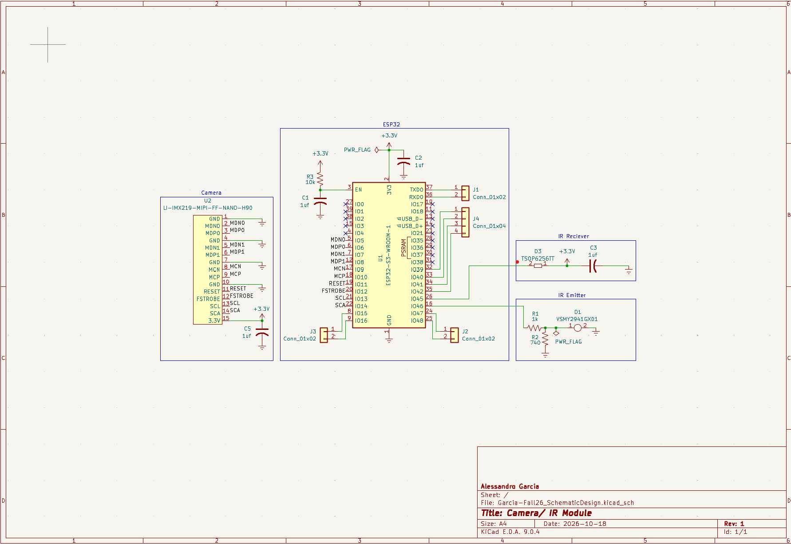

## Overview

This schematic is designed to support a camera and an IR sensor at the front of the robot to act as its eyes. This will help the user visually see what the device comes across during its exploration.

{style width:"350" height:"300;"}
**Figure 01:** PNG of the Camera/ IR module schematic.

## Resouces

The schematic as a PDF download is available [*here*](Garcia-Fall26_SchematicDesign.pdf), and the Zip folder of the project [*here*](Garcia-Fall26_SchematicDesign.zip).